# Freebox PVR


🇫🇷 [Français](#français) · 🇬🇧 [English](#english)

[](https://github.com/akoonet-homeassistant/freebox_pvr/releases)
[](LICENSE)
[](https://hacs.xyz)

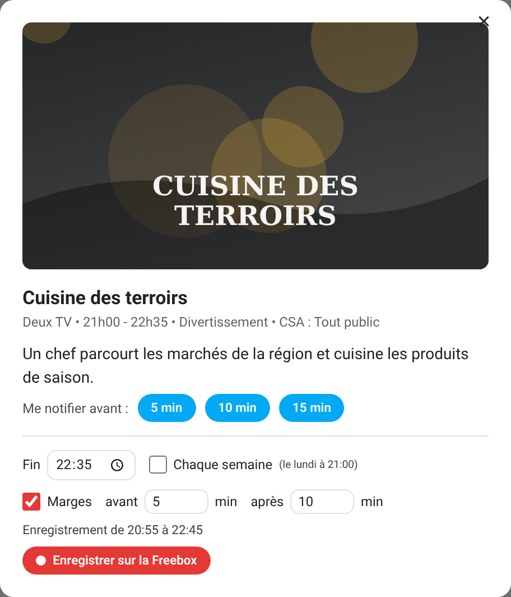

## Français

Freebox PVR programme des **enregistrements TV sur votre Freebox** depuis Home Assistant. Il s'appuie sur le guide [Programme TNT FR](https://github.com/cyclope205/programme-tnt-fr) : vous choisissez une chaîne et un programme, Freebox PVR retrouve la chaîne côté Freebox et programme l'enregistrement sur le disque du Freebox Server.

> L'API d'enregistrement (PVR) de Freebox OS est indiquée comme « instable » par Free : elle peut changer sans préavis.

### Prérequis

- Home Assistant 2025.2 ou plus récent.
- Une Freebox dont le Server enregistre la TV sur son disque. Testé sur **Freebox Revolution** ; les autres modèles qui utilisent la même API devraient fonctionner, sans garantie.
- L'intégration [Programme TNT FR](https://github.com/cyclope205/programme-tnt-fr) pour enregistrer depuis le guide et pour les cartes. Sans elle, l'action `freebox_pvr.record` fonctionne avec une chaîne, un titre et des horaires saisis à la main.

### Fonctionnalités

- **Enregistrer depuis le guide** : le programme en cours, le suivant, la première ou la deuxième partie de soirée d'un capteur Programme TNT FR, en un seul appel.
- **Enregistrer à la main** : chaîne, titre, sous-titre, début et fin.
- **Recherche de la chaîne** à partir du nom du guide (accents, « + », « HD »… gérés), avec des **correspondances manuelles** si besoin.
- **Marges** avant et après réglables dans les options, et modifiables ou désactivables à chaque enregistrement, **qualité** au choix (automatique, HD, SD, basse définition), modifiables pour chaque enregistrement.
- **Heure de fin modifiable** au moment d'enregistrer : si elle est avant l'heure de début, c'est le lendemain (23:30 → 00:45).
- **Répéter chaque semaine** : même chaîne, même jour, même horaire ; chaque semaine, l'enregistrement suivant est programmé sur la Freebox. Une occurrence annulée n'est pas recréée. Le jour de la diffusion, le guide est vérifié : même titre → sous-titre de l'épisode et horaire mis à jour ; titre différent → notification pour décider (Annuler / Garder).
- **Pas de doublon** : un 2e appel pour le même programme renvoie l'enregistrement existant.
- **Programme déjà commencé** : l'enregistrement démarre tout de suite.
- **Gérer les enregistrements** : consulter les enregistrements à venir et ceux déjà enregistrés sur le disque ; mettre en pause / reprendre un enregistrement ou une répétition ; arrêter un enregistrement en cours ; annuler ; supprimer un enregistrement terminé.
- **Entités** : enregistrements programmés (avec leur liste), prochain enregistrement, enregistrement en cours.
- **Bouton dans la carte Programme TNT FR** : la fiche de chaque programme (carrousels, Guide TV, Top films) propose « Enregistrer sur la Freebox », ou indique que le programme est déjà enregistré avec un bouton pour l'annuler. Rien à configurer.
- **Carte du tableau de bord** « Freebox PVR » : le programme TV (maintenant, ce soir) avec un bouton d'enregistrement sur chaque programme, et la liste des enregistrements. Aucune ressource à ajouter.
- **Interface en français et en anglais**, selon la langue de l'utilisateur.

### Installation

#### Par HACS (dépôt personnalisé)

[](https://my.home-assistant.io/redirect/hacs_repository/?owner=akoonet-homeassistant&repository=freebox_pvr&category=integration)

1. Dans HACS, ajoutez `https://github.com/akoonet-homeassistant/freebox_pvr` comme dépôt personnalisé (catégorie *Intégration*), ou utilisez le bouton ci-dessus.
2. Installez **Freebox PVR**, puis redémarrez Home Assistant.
3. *Paramètres → Appareils et services → Ajouter une intégration* → **Freebox PVR**.

#### Manuelle

Copiez `custom_components/freebox_pvr` dans le dossier `custom_components` de votre configuration, redémarrez, puis ajoutez l'intégration.

### Configuration

1. Indiquez l'adresse et le port de la Freebox. L'assistant reprend ceux de l'intégration Freebox officielle si elle est installée, sinon `mafreebox.freebox.fr` (port 443). Home Assistant doit être sur le réseau local de la Freebox pour l'autorisation de l'application.
2. Cliquez sur **Valider**, puis appuyez dans la minute sur la **flèche droite** de l'écran du Freebox Server.
3. Dans Freebox OS → *Paramètres de la Freebox → Gestion des accès → Applications*, ouvrez « Home Assistant - Freebox PVR » et donnez le droit sur les **enregistrements TV (PVR)**.
4. Revenez dans Home Assistant et cliquez de nouveau sur **Valider**.

L'autorisation sur l'écran n'est demandée qu'une fois : les mises à jour de l'intégration ne la redemandent pas (depuis la 2026.11.4).

Le bouton **Configurer** de l'intégration donne accès aux options :

| Option | Par défaut | Rôle |
|---|---|---|
| Marge avant | 5 min | Minutes enregistrées avant le début |
| Marge après | 10 min | Minutes enregistrées après la fin |
| Qualité | Automatique | Automatique, HD, SD ou basse définition |
| Prévenir ces appareils | aucun | Téléphones (application mobile) qui reçoivent l'alerte « programme différent » d'une répétition, avec les boutons Annuler / Garder. L'alerte s'affiche toujours aussi dans Home Assistant |
| Correspondances de chaînes | vide | Une par ligne : `Nom du guide = Nom Freebox` (ou `uuid-webtv-…`). Seulement si une chaîne n'est pas trouvée |

### Utilisation

Enregistrer le prime time de France 2 :

```yaml
action: freebox_pvr.record
data:
  entity_id: sensor.programme_tnt_fr_france_2
  slot: prime_time
```

Bouton de tableau de bord, avec confirmation :

```yaml
type: button
name: Enregistrer le prime time de France 2
icon: mdi:record-rec
tap_action:
  action: perform-action
  perform_action: freebox_pvr.record
  data:
    entity_id: sensor.programme_tnt_fr_france_2
    slot: prime_time
  confirmation:
    text: Programmer l'enregistrement sur la Freebox ?
```

Enregistrer la 2e partie de soirée jusqu'à 00:45, chaque semaine :

```yaml
action: freebox_pvr.record
data:
  entity_id: sensor.programme_tnt_fr_france_2
  slot: second_part
  end_time: "00:45"        # le lendemain si l'heure est avant le début
  repeat_weekly: true
```

Enregistrer un programme saisi à la main :

```yaml
action: freebox_pvr.record
data:
  channel_name: TF1
  title: Le film du dimanche
  start: "2026-11-29 21:10:00"
  end: "2026-11-29 23:00:00"
  margin_after: 15
```

### Dans la carte Programme TNT FR

Si la carte [Programme TNT FR](https://github.com/cyclope205/programme-tnt-fr) est sur votre tableau de bord, ouvrez la fiche d'un programme (appui sur une affiche, une ligne du Guide TV ou du Top films) : une ligne Freebox PVR s'ajoute sous les rappels.

- **Fin** : heure de fin, préremplie avec celle du programme. Si elle est avant l'heure de début, « (le lendemain) » s'affiche : l'enregistrement se termine le jour suivant.
- **Chaque semaine** : répète l'enregistrement chaque semaine, le même jour à la même heure.
- **Marges** : cochées par défaut avec les valeurs des options de l'intégration ; modifiables pour cet enregistrement (0 à 60 min avant, 0 à 120 min après) ou désactivées en décochant la case. La ligne « Enregistrement de … à … » donne les heures réelles, marges comprises.
- **Enregistrer sur la Freebox** : programme l'enregistrement, avec les marges des options. Fonctionne aussi pour les jours suivants dans le Guide TV, et pour un programme déjà commencé (l'enregistrement démarre tout de suite).
- **Enregistrement programmé** : le programme est déjà enregistré (depuis Home Assistant, le Player ou Freebox OS), avec ses horaires réels (marges comprises) et ↻ s'il est répété. **Mettre en pause** le désactive sans le supprimer (**Reprendre** le réactive) ; pendant l'enregistrement, **Arrêter l'enregistrement** puis **Confirmer l'arrêt** le termine en gardant la partie enregistrée. **Annuler l'enregistrement** puis **Confirmer l'annulation** le supprime. **Répéter chaque semaine** ajoute la répétition ; **Arrêter la répétition** puis **Confirmer l'arrêt** l'arrête et supprime les enregistrements des semaines suivantes déjà programmés (celui du programme affiché est gardé).
- **Chaîne introuvable sur la Freebox** : ajoutez une correspondance dans les options de l'intégration.

La carte Programme TNT FR n'est pas modifiée : Freebox PVR complète sa fiche au moment où elle s'ouvre. Si une future version de cette carte change son fonctionnement interne, la ligne n'apparaît simplement plus (message dans la console du navigateur) et la carte fonctionne comme avant.

### Carte du tableau de bord

Modifier le tableau de bord → **Ajouter une carte** → **Freebox PVR**. Tout se règle dans l'éditeur visuel ; en YAML :

```yaml
type: custom:freebox-pvr-card
title: Programme TV          # facultatif
onglet: soir                 # maintenant | soir | enregistrements
chaines:                     # facultatif : vide = toutes les chaînes du guide, sinon dans cet ordre
  - sensor.programme_tnt_fr_tf1
  - sensor.programme_tnt_fr_france_2
  - sensor.programme_tnt_fr_m6
afficher_affiches: true      # affiche dans le détail d'un programme
pvr_entity: sensor.freebox_pvr_enregistrements_programmes   # facultatif : trouvé automatiquement
```

- **Maintenant** : programme en cours (avec sa progression) et suivant. **Ce soir** : première et deuxième partie de soirée. **Enregistrements** : la liste de la Freebox, avec leur état et les conflits.
- **Bouton d'enregistrement** (rond rouge) : un appui programme l'enregistrement. Le programme passe en rouge quand il est enregistré (la Freebox fait foi). Un nouvel appui propose « Annuler ? » pendant 4 secondes ; un 2e appui annule.
- Bouton grisé : la chaîne n'a pas été trouvée sur la Freebox ; ajoutez une correspondance dans les options de l'intégration.
- Un appui sur un programme affiche son résumé, sa note, son affiche, et les réglages d'enregistrement (heure de fin, chaque semaine) comme dans la fiche Programme TNT FR.
- L'onglet **Enregistrements** a deux vues :
  - **À venir** : enregistrements programmés, en cours et en pause, avec ❙❙ mettre en pause / ► reprendre, ✕ annuler, ■ arrêter (en cours) ; puis les **répétitions chaque semaine**, avec mettre en pause / reprendre et arrêter la répétition.
  - **Terminés** : enregistrements présents sur le disque de la Freebox (chaîne, date, durée, taille), du plus récent au plus ancien, avec la corbeille pour supprimer (le fichier est effacé).
  - Les actions qui suppriment ou arrêtent demandent une confirmation (« Confirmer ? », 4 secondes).

### Captures d'écran

**Dans la carte Programme TNT FR**

| | |
|---|---|
| **Carrousel** (4 affiches par rangée)<br> | **Fiche** — fin, chaque semaine, marges<br> |
| **Fiche** — fin après minuit, répétée chaque semaine, marge après modifiée<br>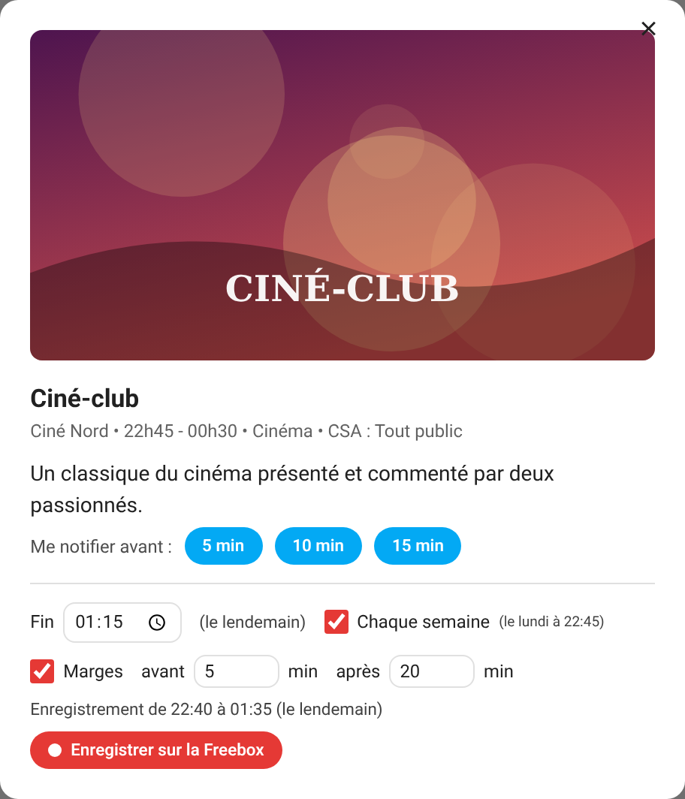 | **Fiche** — sans marges<br> |
| **Fiche** — programme déjà enregistré et répété<br>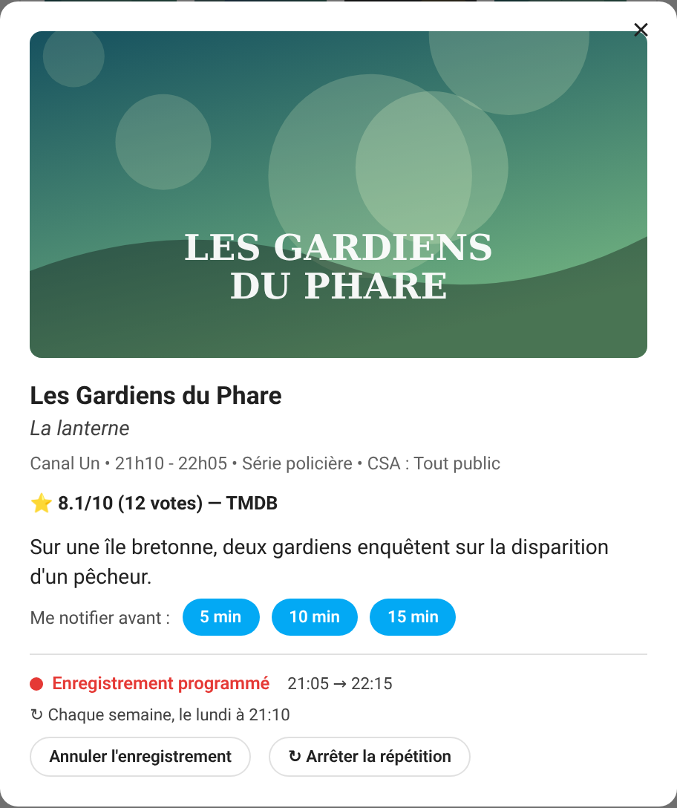 | **Fiche** — arrêt de la répétition<br>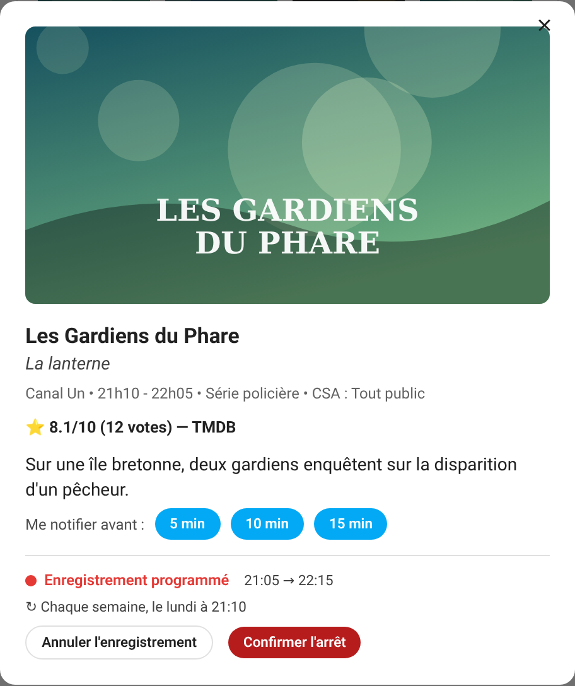 |
| **Fiche** — enregistrement en pause<br> | **Fiche** — enregistrement en cours<br>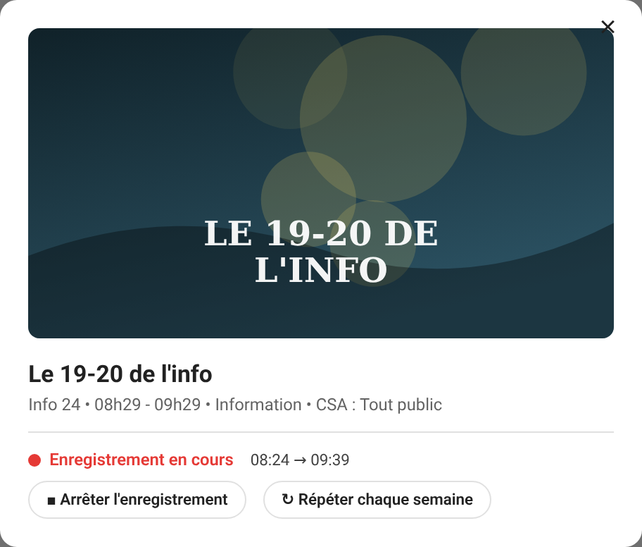 |
| **Fiche** — thème sombre<br>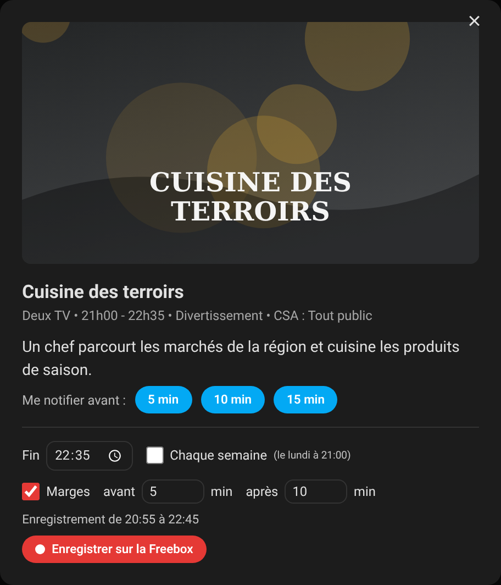 | |

**Carte Freebox PVR**

| | |
|---|---|
| **Ce soir** — deux programmes enregistrés, une chaîne introuvable<br>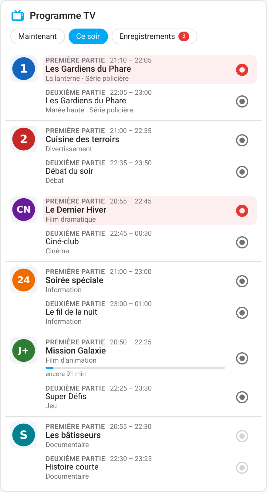 | **Maintenant** — progression et détail d'un programme<br>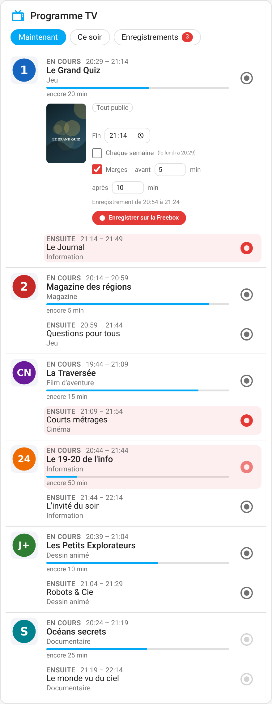 |
| **Enregistrements à venir** — en cours, en pause, prévus, répétitions<br>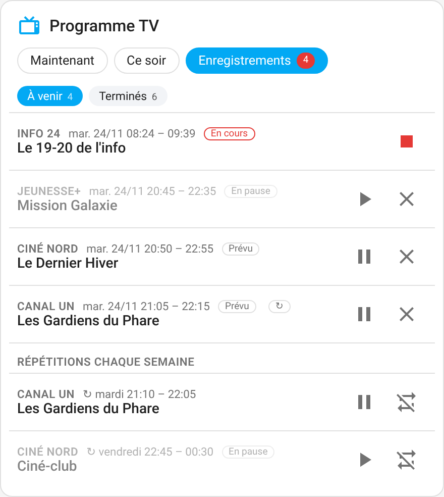 | **Enregistrements terminés** — sur le disque de la Freebox<br>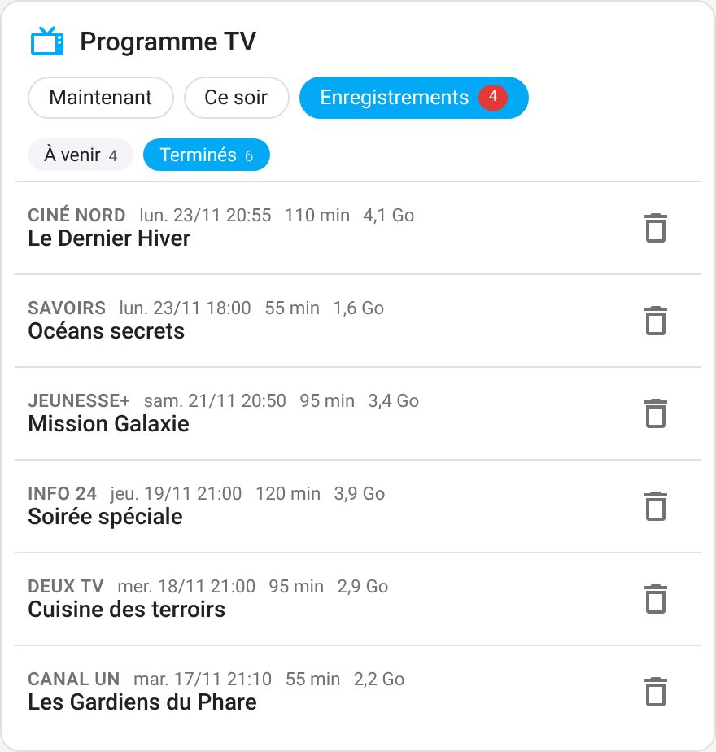 |
| **Annulation** — confirmation en un appui<br>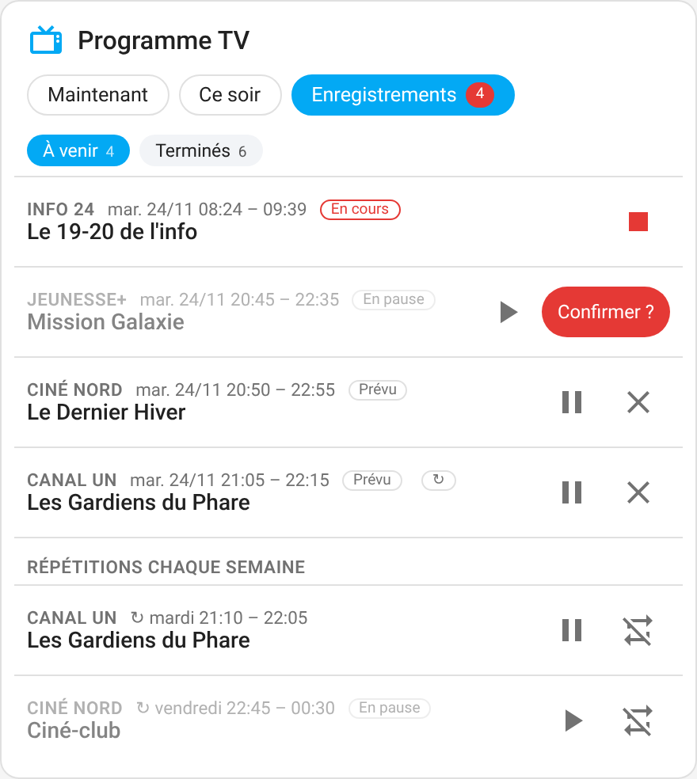 | **Détail d'un programme** — réglages d'enregistrement<br>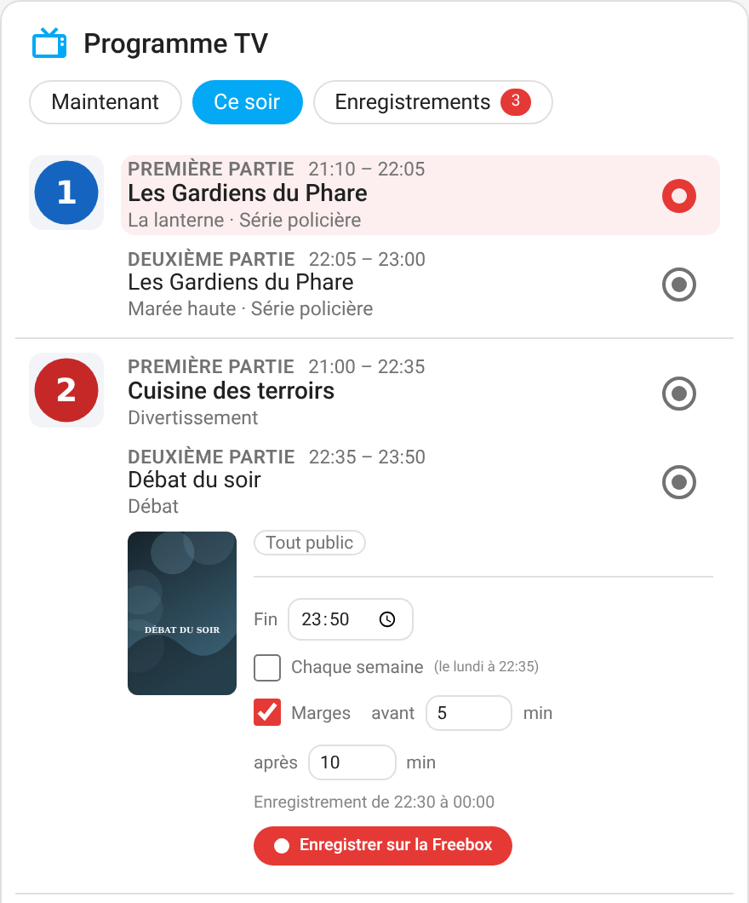 |
| **Thème sombre**<br>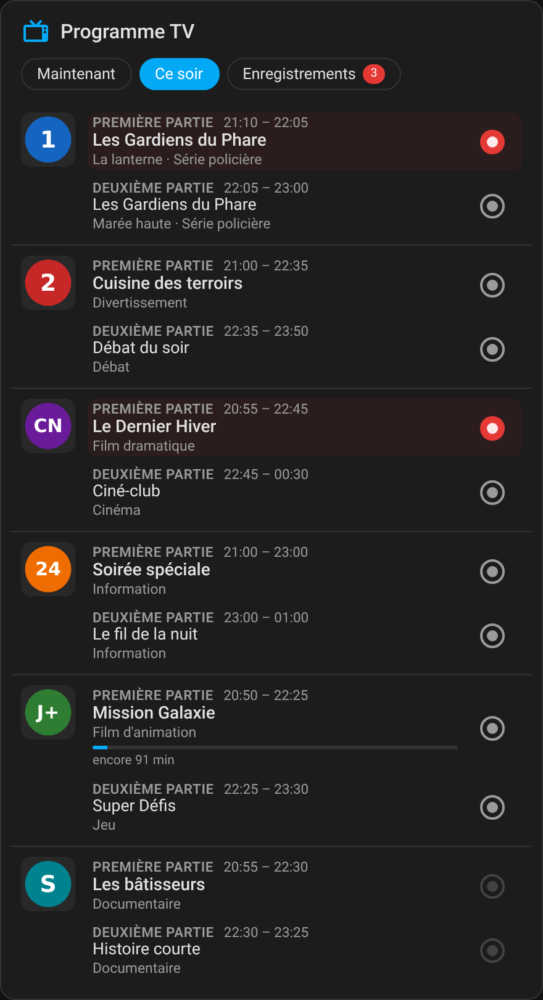 | |
| **En anglais**<br>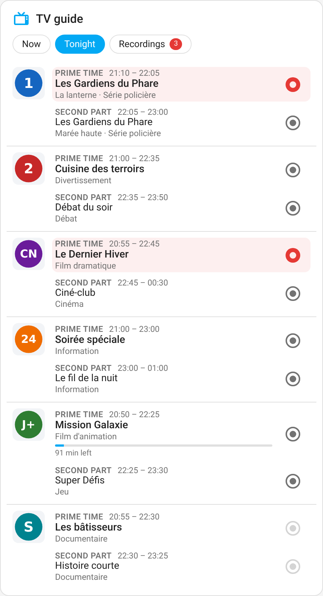 | |

*Captures réalisées sur une installation de démonstration : chaînes, programmes, affiches et logos sont fictifs. La carte Programme TNT FR est celle de [cyclope205](https://github.com/cyclope205/programme-tnt-fr), affichée telle quelle avec la ligne ajoutée par Freebox PVR.*

### Entités

| Entité | Rôle |
|---|---|
| `sensor.freebox_pvr_enregistrements_programmes` | Nombre d'enregistrements à venir ou en cours (hors pause). Attributs : `paused` (nombre en pause), `records` (à venir, en cours et en pause : id, titre, sous-titre, chaîne, début, fin, état, erreur, conflit, horaires en timestamp `start_ts` / `end_ts`), `conflicts` (nombre), `failed` (5 derniers échecs), `guide_channels` (chaîne du guide → identifiant Freebox, `null` si introuvable : utile pour vérifier les correspondances), `repeats` (répétitions : id, titre, chaîne, jour 0 = lundi, heure, durée en minutes, prochain début). Chaque enregistrement a aussi `repeat_id` s'il vient d'une répétition |
| `sensor.freebox_pvr_enregistrements_termines` | Nombre d'enregistrements terminés sur le disque. Attributs : `recordings` (les 50 plus récents : id, titre, sous-titre, chaîne, début, fin, durée en secondes, taille en octets, état), `total_size` (octets) |
| `sensor.freebox_pvr_prochain_enregistrement` | Heure de début du prochain enregistrement (marge comprise) ; attributs du programme |
| `binary_sensor.freebox_pvr_enregistrement_en_cours` | Allumé pendant un enregistrement ; attribut `records` |

Les identifiants exacts dépendent de la langue de Home Assistant au moment de l'installation, et du nom de l'appareil (par exemple `sensor.salon_freebox_pvr_…` si l'appareil a été renommé ou rangé dans une pièce). Début et fin incluent les marges.

### Services

| Service | Rôle |
|---|---|
| `freebox_pvr.record` | Programme un enregistrement. Depuis un capteur du guide (`entity_id` + `slot` : `current`, `next`, `prime_time`, `second_part`) ou à la main (`channel_name` ou `channel_uuid`, `title`, `subtitle`, `start`, `end`). `end_time` (HH:MM) change l'heure de fin, le lendemain si elle est avant le début ; sur un programme déjà enregistré, elle modifie la fin de l'enregistrement. `repeat_weekly: true` répète chaque semaine. `margin_before`, `margin_after` et `quality` remplacent les options. Réponse : `record_id`, `already_programmed`, `repeat_id`, `channel_name`, `start`, `end`, `conflict` |
| `freebox_pvr.cancel` | Annule un enregistrement programmé : par `record_id`, ou par programme (`entity_id` + `slot`, ou `channel_name` + `start`) |
| `freebox_pvr.pause_record` / `freebox_pvr.resume_record` | Met en pause (désactive sans supprimer) / reprend un enregistrement programmé (`record_id`) |
| `freebox_pvr.stop_record` | Arrête un enregistrement en cours (`record_id`) : la fin est avancée à maintenant, la partie enregistrée est gardée |
| `freebox_pvr.delete_finished` | Supprime un enregistrement terminé et son fichier (`record_id`, voir le capteur des enregistrements terminés) |
| `freebox_pvr.pause_repeat` / `freebox_pvr.resume_repeat` | Met en pause / reprend une répétition (`repeat_id`) : en pause, aucun nouvel épisode n'est programmé et les épisodes déjà programmés sont mis en pause ; à la reprise, ils reprennent et les semaines suivantes sont de nouveau programmées |
| `freebox_pvr.stop_repeat` | Arrête une répétition (`repeat_id`). Les enregistrements déjà programmés sont gardés, sauf avec `cancel_scheduled: true` (`keep_record_id` en garde un) |
| `freebox_pvr.refresh_channels` | Recharge la liste des chaînes de la Freebox (faite automatiquement toutes les 6 h) |

### Sécurité

- La carte et la surcouche n'appellent que les services `freebox_pvr.record`, `freebox_pvr.cancel` et `freebox_pvr.stop_repeat` ; les textes du guide sont affichés sans être interprétés (pas d'injection HTML) et seules les images en `http(s)` sont chargées.
- Le jeton d'application est stocké dans `.storage/freebox_pvr/`, comme pour l'intégration Freebox officielle. Il est supprimé quand l'intégration est retirée ; révoquez aussi l'application dans Freebox OS.
- Les échanges se font en HTTPS avec vérification du certificat (certificats système et autorité Freebox).
- Seul le droit sur les enregistrements TV (PVR) est nécessaire : vous pouvez retirer à l'application les autres droits accordés par défaut.
- Les services vérifient les valeurs reçues (chaîne retrouvée par son nom, horaires cohérents et à venir, marges de 0 à 60 min avant et de 0 à 120 min après) ; ils ne peuvent que créer ou supprimer des enregistrements programmés. Un `channel_uuid` donné directement est transmis tel quel à la Freebox.

### Limites

- L'API PVR de Freebox OS peut évoluer sans préavis (Free la considère comme instable).
- Seule la Freebox Revolution a été testée.
- **Répétition** : gérée par l'intégration et non par la Freebox (l'API de répétition native de Free n'est pas documentée). L'enregistrement de la semaine suivante est programmé jusqu'à 8 jours à l'avance, à chaque mise à jour (toutes les 5 minutes) : Home Assistant doit tourner au moins une fois dans la semaine. Le jour de la diffusion (dans les 24 h), l'intégration compare chaque enregistrement répété au guide Programme TNT FR : si le même titre est annoncé, elle met à jour le sous-titre de l'épisode et, si l'émission est décalée (jusqu'à 1 h 30), l'horaire ; si un autre programme est annoncé, elle envoie une notification (une seule par semaine) avec « Annuler cet enregistrement » / « Garder ». Sans réponse, l'enregistrement est gardé. Avant ce jour-là, le guide n'est pas encore connu : l'épisode suivant est programmé sur le créneau habituel, sans sous-titre. Les répétitions sont enregistrées dans `.storage/freebox_pvr.<id>.repeats`.
- **Modifier un enregistrement déjà programmé** (fin, mise en pause / reprise, arrêt en cours, ou sous-titre et horaire mis à jour par le guide) utilise l'API de modification de la Freebox, qui n'a pas encore été testée sur une vraie box.
- Le Freebox Server doit avoir un disque pour les enregistrements.
- Les conflits (deux enregistrements en même temps) sont signalés par la Freebox dans l'attribut `conflict`, pas résolus par l'intégration.

---

## English

Freebox PVR schedules **TV recordings on your Freebox** from Home Assistant. It works with the [Programme TNT FR](https://github.com/cyclope205/programme-tnt-fr) TV guide: pick a channel and a program, Freebox PVR finds the channel on the Freebox side and schedules the recording on the Freebox Server disk.

> Free flags the Freebox OS recording (PVR) API as "unstable": it may change without notice.

### Requirements

- Home Assistant 2025.2 or newer.
- A Freebox whose Server records TV on its disk. Tested on **Freebox Revolution**; other models using the same API should work, without guarantee.
- The [Programme TNT FR](https://github.com/cyclope205/programme-tnt-fr) integration to record from the guide and for the cards. Without it, the `freebox_pvr.record` action works with a channel, a title and times given by hand.

### Features

- **Record from the guide**: the current, next, prime time or second-part program of a Programme TNT FR sensor, in a single call.
- **Record by hand**: channel, title, subtitle, start and end.
- **Channel lookup** from the guide name (accents, "+", "HD"… handled), with **manual matches** when needed.
- **Margins** before and after set in the options, and adjustable or turned off for each recording, selectable **quality** (automatic, HD, SD, low definition), overridable per recording.
- **Adjustable end time** when recording: if it is earlier than the start time, it is the next day (23:30 → 00:45).
- **Repeat every week**: same channel, same day, same time slot; every week, the next recording is scheduled on the Freebox. A cancelled occurrence is not recreated. On broadcast day, the guide is checked: same title → episode subtitle and time updated; different title → notification to decide (Cancel / Keep).
- **No duplicates**: a second call for the same program returns the existing recording.
- **Program already started**: recording starts right away.
- **Manage recordings**: view upcoming recordings and those already recorded on the disk; pause / resume a recording or a repeat; stop a recording in progress; cancel; delete a finished recording.
- **Entities**: scheduled recordings (with their list), next recording, recording in progress.
- **Button in the Programme TNT FR card**: each program sheet (carousels, TV guide, top films) offers "Record on the Freebox", or shows that the program is already recorded with a button to cancel it. Nothing to set up.
- **"Freebox PVR" dashboard card**: the TV guide (now, tonight) with a record button on each program, and the list of recordings. No resource to add.
- **French and English interface**, following the user's language.

### Installation

#### With HACS (custom repository)

[](https://my.home-assistant.io/redirect/hacs_repository/?owner=akoonet-homeassistant&repository=freebox_pvr&category=integration)

1. In HACS, add `https://github.com/akoonet-homeassistant/freebox_pvr` as a custom repository (category *Integration*), or use the button above.
2. Install **Freebox PVR**, then restart Home Assistant.
3. *Settings → Devices & services → Add integration* → **Freebox PVR**.

#### Manual

Copy `custom_components/freebox_pvr` into the `custom_components` folder of your configuration, restart, then add the integration.

### Setup

1. Enter the Freebox address and port. The wizard reuses those of the official Freebox integration if it is installed, otherwise `mafreebox.freebox.fr` (port 443). Home Assistant must be on the Freebox local network to authorize the app.
2. Click **Submit**, then within a minute press the **right arrow** on the Freebox Server screen.
3. In Freebox OS → *Freebox settings → Access management → Applications*, open "Home Assistant - Freebox PVR" and grant the **TV recording (PVR)** permission.
4. Back in Home Assistant, click **Submit** again.

The on-screen authorization is only requested once: integration updates do not ask for it again (since 2026.11.4).

The integration's **Configure** button opens the options:

| Option | Default | Purpose |
|---|---|---|
| Margin before | 5 min | Minutes recorded before the start |
| Margin after | 10 min | Minutes recorded after the end |
| Quality | Automatic | Automatic, HD, SD or low definition |
| Notify these devices | none | Phones (mobile app) that receive the "different program" alert of a repeat, with Cancel / Keep buttons. The alert is always also shown in Home Assistant |
| Channel matches | empty | One per line: `Guide name = Freebox name` (or `uuid-webtv-…`). Only if a channel is not found |

### Usage

Record France 2 prime time:

```yaml
action: freebox_pvr.record
data:
  entity_id: sensor.programme_tnt_fr_france_2
  slot: prime_time
```

Dashboard button, with confirmation:

```yaml
type: button
name: Record France 2 prime time
icon: mdi:record-rec
tap_action:
  action: perform-action
  perform_action: freebox_pvr.record
  data:
    entity_id: sensor.programme_tnt_fr_france_2
    slot: prime_time
  confirmation:
    text: Schedule the recording on the Freebox?
```

Record the second part until 00:45, every week:

```yaml
action: freebox_pvr.record
data:
  entity_id: sensor.programme_tnt_fr_france_2
  slot: second_part
  end_time: "00:45"        # next day if earlier than the start
  repeat_weekly: true
```

Record a program given by hand:

```yaml
action: freebox_pvr.record
data:
  channel_name: TF1
  title: Sunday movie
  start: "2026-11-29 21:10:00"
  end: "2026-11-29 23:00:00"
  margin_after: 15
```

### In the Programme TNT FR card

If the [Programme TNT FR](https://github.com/cyclope205/programme-tnt-fr) card is on your dashboard, open a program sheet (tap a poster, a TV guide or top films row): a Freebox PVR line is added below the reminders.

- **End**: end time, prefilled with the program's. If it is earlier than the start time, "(next day)" is shown: the recording ends on the following day.
- **Every week**: repeats the recording every week, on the same day at the same time.
- **Margins**: checked by default with the integration option values; adjustable for this recording (0 to 60 min before, 0 to 120 min after) or turned off by unchecking the box. The "Recording from … to …" line gives the actual times, margins included.
- **Record on the Freebox**: schedules the recording, with the option margins. Also works for the next days in the TV guide, and for a program already started (recording starts right away).
- **Recording scheduled**: the program is already recorded (from Home Assistant, the Player or Freebox OS), with its actual times (margins included) and ↻ if repeated. **Pause** disables it without deleting it (**Resume** enables it again); while recording, **Stop the recording** then **Confirm stop** ends it and keeps what was recorded. **Cancel the recording** then **Confirm cancellation** deletes it. **Repeat every week** adds the repeat; **Stop repeating** then **Confirm stop** stops it and deletes the already scheduled recordings of the following weeks (the one of the displayed program is kept).
- **Channel not found on the Freebox**: add a match in the integration options.

The Programme TNT FR card is not modified: Freebox PVR completes its sheet when it opens. If a future version of that card changes how it works internally, the line simply no longer appears (message in the browser console) and the card works as before.

### Dashboard card

Edit dashboard → **Add card** → **Freebox PVR**. Everything is set in the visual editor; in YAML:

```yaml
type: custom:freebox-pvr-card
title: TV guide              # optional
onglet: soir                 # maintenant (now) | soir (tonight) | enregistrements (recordings)
chaines:                     # optional: empty = all guide channels, otherwise in this order
  - sensor.programme_tnt_fr_tf1
  - sensor.programme_tnt_fr_france_2
  - sensor.programme_tnt_fr_m6
afficher_affiches: true      # poster in the program details
pvr_entity: sensor.freebox_pvr_scheduled_recordings   # optional: found automatically
```

- **Now**: current program (with progress) and next. **Tonight**: prime time and second part. **Recordings**: the Freebox list, with state and conflicts.
- **Record button** (red circle): one tap schedules the recording. The program turns red once recorded (the Freebox is the reference). Another tap shows "Cancel?" for 4 seconds; a second tap cancels.
- Greyed button: the channel was not found on the Freebox; add a match in the integration options.
- Tapping a program shows its summary, rating, poster, and the recording settings (end time, every week) as in the Programme TNT FR sheet.
- The **Recordings** tab has two views:
  - **Upcoming**: scheduled, running and paused recordings, with pause / resume, cancel, stop (while recording); then the **weekly repeats**, with pause / resume and stop the repeat.
  - **Finished**: recordings on the Freebox disk (channel, date, duration, size), newest first, with the bin to delete (the file is erased).
  - Actions that delete or stop ask for confirmation ("Confirm?", 4 seconds).

### Screenshots

See the [French section](#captures-décran) (demo installation: channels, programs, posters and logos are fictitious).

### Entities

| Entity | Purpose |
|---|---|
| `sensor.freebox_pvr_scheduled_recordings` | Number of upcoming or running recordings (paused excluded). Attributes: `paused` (number paused), `records` (upcoming, running and paused: id, title, subtitle, channel, start, end, state, error, conflict, `start_ts` / `end_ts` timestamps), `conflicts` (count), `failed` (last 5 failures), `guide_channels` (guide channel → Freebox ID, `null` if not found: handy to check matches), `repeats` (weekly repeats: id, title, channel, weekday 0 = Monday, time, duration in minutes, next start). Each recording also has `repeat_id` if it comes from a repeat |
| `sensor.freebox_pvr_finished_recordings` | Number of finished recordings on the disk. Attributes: `recordings` (the 50 most recent: id, title, subtitle, channel, start, end, duration in seconds, size in bytes, state), `total_size` (bytes) |
| `sensor.freebox_pvr_next_recording` | Start time of the next recording (margin included); program attributes |
| `binary_sensor.freebox_pvr_recording_in_progress` | On while recording; `records` attribute |

Exact entity IDs depend on the Home Assistant language at installation time, and on the device name (e.g. `sensor.salon_freebox_pvr_…` if the device was renamed or placed in an area). Start and end include the margins.

### Services

| Service | Purpose |
|---|---|
| `freebox_pvr.record` | Schedules a recording. From a guide sensor (`entity_id` + `slot`: `current`, `next`, `prime_time`, `second_part`) or by hand (`channel_name` or `channel_uuid`, `title`, `subtitle`, `start`, `end`). `end_time` (HH:MM) changes the end time, next day if earlier than the start; on an already recorded program, it changes the recording's end. `repeat_weekly: true` repeats every week. `margin_before`, `margin_after` and `quality` override the options. Response: `record_id`, `already_programmed`, `repeat_id`, `channel_name`, `start`, `end`, `conflict` |
| `freebox_pvr.cancel` | Cancels a scheduled recording: by `record_id`, or by program (`entity_id` + `slot`, or `channel_name` + `start`) |
| `freebox_pvr.pause_record` / `freebox_pvr.resume_record` | Pauses (disables without deleting) / resumes a scheduled recording (`record_id`) |
| `freebox_pvr.stop_record` | Stops a recording in progress (`record_id`): the end is moved to now, what was recorded is kept |
| `freebox_pvr.delete_finished` | Deletes a finished recording and its file (`record_id`, see the finished recordings sensor) |
| `freebox_pvr.pause_repeat` / `freebox_pvr.resume_repeat` | Pauses / resumes a repeat (`repeat_id`): while paused, no new episode is scheduled and already scheduled episodes are paused; on resume, they resume and the following weeks are scheduled again |
| `freebox_pvr.stop_repeat` | Stops a repeat (`repeat_id`). Already scheduled recordings are kept, unless `cancel_scheduled: true` (`keep_record_id` keeps one) |
| `freebox_pvr.refresh_channels` | Reloads the Freebox channel list (done automatically every 6 hours) |

### Security

- The card and the overlay only call the `freebox_pvr.record`, `freebox_pvr.cancel` and `freebox_pvr.stop_repeat` services; guide texts are displayed without being interpreted (no HTML injection) and only `http(s)` images are loaded.
- The app token is stored in `.storage/freebox_pvr/`, like the official Freebox integration. It is deleted when the integration is removed; also revoke the app in Freebox OS.
- Traffic uses HTTPS with certificate verification (system certificates and Freebox authority).
- Only the TV recording (PVR) permission is needed: you can remove the other permissions granted by default.
- Services check the values they receive (channel found by its name, consistent upcoming times, margins of 0 to 60 min before and 0 to 120 min after); they can only create or delete scheduled recordings. A `channel_uuid` given directly is passed as is to the Freebox.

### Limitations

- The Freebox OS PVR API may change without notice (Free considers it unstable).
- Only the Freebox Revolution has been tested.
- **Repeat**: handled by the integration, not by the Freebox (Free's native repeat API is not documented). The next week's recording is scheduled up to 8 days ahead, at every update (every 5 minutes): Home Assistant must run at least once a week. On broadcast day (within 24 hours), the integration compares each repeated recording with the Programme TNT FR guide: if the same title is listed, it updates the episode subtitle and, if the show is shifted (up to 1.5 hours), the time; if another program is listed, it sends a notification (once a week) with "Cancel this recording" / "Keep". Without an answer, the recording is kept. Before that day the guide is not known yet: the next episode is scheduled on the usual slot, without subtitle. Repeats are stored in `.storage/freebox_pvr.<id>.repeats`.
- **Changing an already scheduled recording** (end time, pause / resume, stop while recording, or subtitle and time updated from the guide) uses the Freebox edit API, not yet tested on a real box.
- The Freebox Server needs a disk for recordings.
- Conflicts (two recordings at the same time) are reported by the Freebox in the `conflict` attribute, not resolved by the integration.
