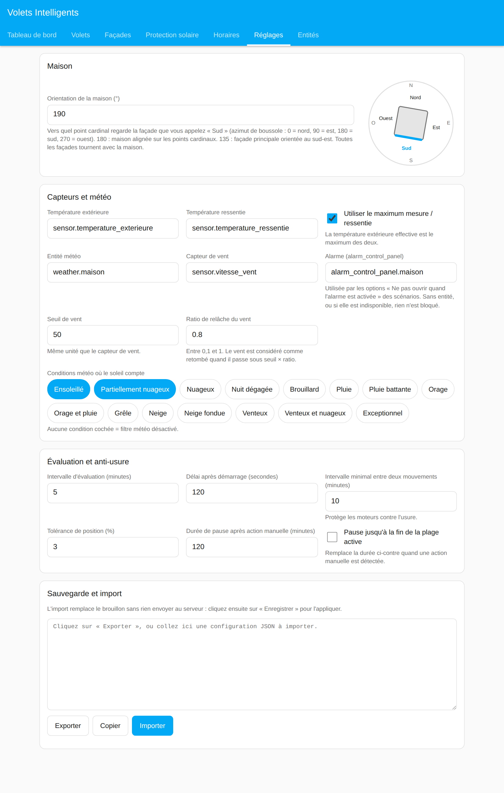
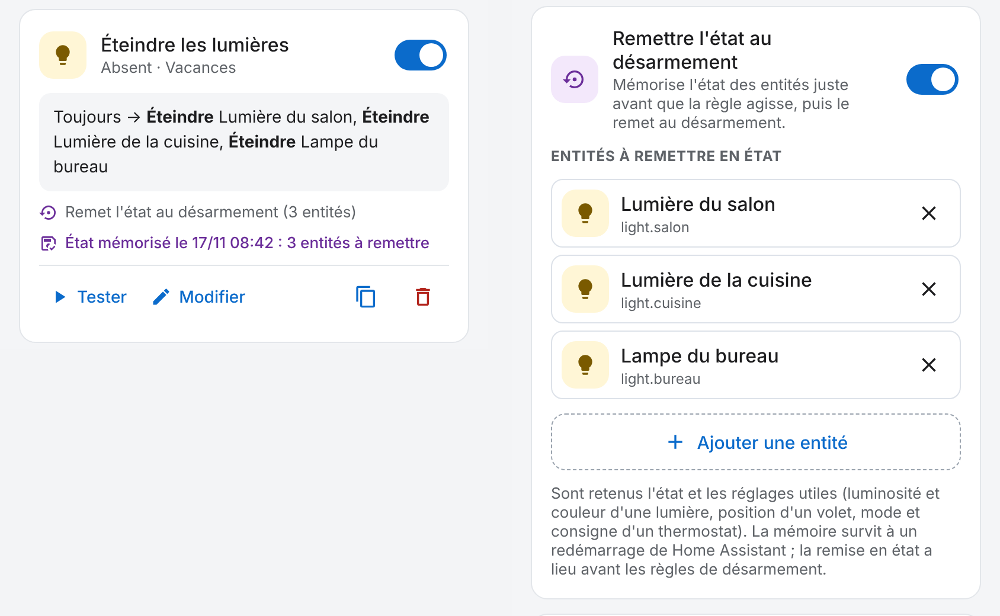

# Protocole Alarme


🇫🇷 [Français](#français) · 🇬🇧 [English](#english)

[](https://github.com/akoonet-homeassistant/protocole_alarme/releases)
[](LICENSE)
[](https://hacs.xyz)


## Français

Protocole Alarme lance des actions quand vous **armez** ou **désarmez** votre alarme Home Assistant. Vous choisissez entité par entité ce qui doit se passer, sans écrire d'automatisation :

- si une fenêtre est ouverte, fermer le volet de la pièce ;
- si la porte du garage est ouverte, envoyer une impulsion au moteur, puis vérifier qu'elle s'est bien fermée ;
- allumer une lumière, passer le chauffage en éco, démarrer le simulateur de présence ;
- au désarmement, arrêter le simulateur, allumer l'entrée, envoyer une notification…

### Fonctionnalités

- **Assistant en 3 étapes** : *Quand* (armement ou désarmement, modes d'alarme), *Si* (conditions facultatives sur l'état d'entités), *Alors* (actions), puis un récapitulatif lisible.
- **Actions paramétrables selon le type d'entité** : volets (ouvrir, fermer, position), lumières (allumer avec luminosité, éteindre), interrupteurs (allumer, éteindre, **impulsion** de durée réglable), serrures, chauffage (préréglage, température), médias, scènes, scripts, automatisations, listes, vannes, boutons et notifications.
- **Vérification du résultat** : après un délai, contrôle qu'une entité est dans l'état attendu (ex. volet fermé) ; sinon lance **une ou plusieurs actions en cas d'échec** (prévenir, déclencher l'alarme, allumer une lumière…) et active le capteur « Échec de vérification ». Pas de nouvel essai automatique.
- **Notifications** : une action comme une autre, vers un ou plusieurs destinataires — téléphones, Home Assistant et **entités de notification** comme Telegram (envoyées par `notify.send_message`).
- **Messages avec variables** : `{{ regle }}` et `{{ entite }}` (l'entité qui a déclenché la règle) dans toutes les notifications ; en cas d'échec, `{{ entite }}` est l'entité vérifiée et `{{ etat_actuel }}`, `{{ etat_attendu }}` sont disponibles. Un aperçu montre le message rempli ; les états reprennent les libellés de Home Assistant.
- **Personnes autorisées** : en plus des administrateurs, d'autres utilisateurs peuvent être autorisés à modifier les règles (onglet Réglages).
- **Choix d'entité lisible** : recherche, filtres par type, et pour chaque entité son type (Fenêtre, Porte de garage, Mouvement…), son état et son icône.
- **Surveillance pendant l'armement** (option) : si la condition d'une règle d'armement devient vraie alors que l'alarme est déjà armée (ex. une fenêtre s'ouvre), la règle s'exécute aussi. Un retour d'« indisponible » ne déclenche rien.
- **Ne rien faire pendant… après l'armement** (surveillance) : la surveillance ne commence qu'après ce délai (0 à 600 s), le temps que les autres règles ferment les volets.
- **Ignorer si c'est déjà le cas à l'armement** (surveillance) : une fenêtre restée ouverte au moment de l'armement est tolérée jusqu'au désarmement ; seules les nouvelles ouvertures comptent. Évite le conflit avec une règle qui ferme le volet d'une fenêtre ouverte.
- **Tolérer seulement si…** : la tolérance ne vaut que si une autre entité est dans un état donné (ex. le volet de la pièce est fermé). Si le volet se rouvre, ou si la fenêtre se rouvre volet ouvert, la règle s'exécute.
- **Règles classées par type** : Volets et fenêtres, Intrusion, Portes et garage, Lumières et simulation, Chauffage, Notifications, Autres. Le type est proposé d'après les actions et se change dans le récapitulatif.
- **Déclencher l'alarme** : action qui déclenche l'alarme suivie (intrusion).
- **Notification critique** : sur l'application mobile Home Assistant, sonne même en mode silencieux / Ne pas déranger.
- **Mise à jour automatique** des règles des versions précédentes : la liste « Prévenir » de la vérification devient une action de notification, avec le même message.
- **Remettre l'état au désarmement** (règles d'armement) : l'état des entités choisies est mémorisé juste avant que la règle agisse, puis remis au désarmement — avec la luminosité et la couleur d'une lumière, la position d'un volet, le mode et la consigne d'un thermostat. La liste se remplit avec les entités pilotées par la règle et se modifie à la main ; la mémoire survit à un redémarrage de Home Assistant et s'affiche dans la liste des règles. La remise en état passe avant les règles de désarmement, qui gardent le dernier mot.
- **Délai avant exécution** par règle.
- **Annulation** : désarmer l'alarme interrompt les règles d'armement encore en cours (délai, impulsion, vérification), et inversement.
- **Redémarrage de Home Assistant** : ne déclenche aucune règle.
- **Simulateur de présence** : pilote [Lights Simulator](https://github.com/akoonet-homeassistant/lights_simulator) (Démarrer, Repasser en Auto, Arrêter). S'il n'est pas installé, le panneau propose de l'installer par HACS ; s'il suit déjà l'alarme lui-même, un avertissement signale le double pilotage.
- **Modèles** pour démarrer en deux clics (garage, volet, simulateur, lumière, notification, **déclencher l'alarme si une fenêtre s'ouvre**).
- **Mode avancé** : une règle peut être modifiée en YAML (syntaxe des actions de script Home Assistant), avec les variables `regle`, `evenement` et `mode_alarme`.
- **Bouton Tester** : exécute une règle sans armer l'alarme (les conditions restent vérifiées).
- **Journal** des 50 dernières exécutions.
- **Import / export** des règles depuis le panneau (fichier JSON ou presse-papiers), en ajout ou en remplacement.
- **Panneau latéral** « Protocole Alarme » consultable par tous ; création, modification et test réservés aux administrateurs et aux personnes qu'ils autorisent.
- **Types de règles personnalisables** : ajout, renommage, icône, ordre et suppression dans Réglages ; les règles d'un type supprimé vont dans « Autres ». Dans la liste, chaque type se replie ou se déplie (mémorisé sur l'appareil).
- **Carte du tableau de bord** « Protocole Alarme » : armer / désarmer (avec code si l'alarme le demande), bouclier vert quand l'alarme est désarmée et rouge quand elle est armée, règles exécutées depuis le dernier armement ou désarmement (en direct), boutons d'armement colorés par mode, capteurs en pastilles (grisées au repos, orange quand ils sont ouverts ou en détection) dans l'ordre choisi ; listes repliables. Aucune ressource à ajouter.
- **Interface en français et en anglais**, selon la langue de l'utilisateur.

### Installation

#### Par HACS (dépôt personnalisé)

[](https://my.home-assistant.io/redirect/hacs_repository/?owner=akoonet-homeassistant&repository=protocole_alarme&category=integration)

1. Dans HACS, ajoutez `https://github.com/akoonet-homeassistant/protocole_alarme` comme dépôt personnalisé (catégorie *Intégration*), ou utilisez le bouton ci-dessus.
2. Installez **Protocole Alarme**, puis redémarrez Home Assistant.
3. *Paramètres → Appareils et services → Ajouter une intégration* → **Protocole Alarme**, puis choisissez l'alarme à suivre.

#### Manuelle

Copiez `custom_components/protocole_alarme` dans le dossier `custom_components` de votre configuration, redémarrez, puis ajoutez l'intégration.

### Utilisation

Ouvrez le panneau **Protocole Alarme** dans la barre latérale.

| Onglet | Contenu |
|---|---|
| Règles | Règles d'armement et de désarmement, activation, test, modification, duplication, suppression ; ajout par l'assistant ou à partir d'un modèle |
| Entités | Les entités créées, avec leur état |
| Journal | Les dernières exécutions : règle, moment, résultat, détail |
| Réglages | **Général** (alarme suivie, protocole actif ou en pause, Lights Simulator), **Organisation des règles** (types de règles), **Accès** (personnes autorisées à modifier les règles, administrateurs), **Sauvegarde** (import / export) |

Le bouton **Configurer** de l'intégration permet de changer d'alarme et d'afficher ou masquer le panneau dans la barre latérale. Masqué, il reste accessible à l'adresse `/protocole-alarme`.

**Quand une règle s'exécute-t-elle ?** À l'armement, quand l'alarme passe de *désarmée* ou *en cours d'armement* à un état *armée* (absent, nuit, présent, vacances, personnalisé). Au désarmement, quand elle repasse à *désarmée* depuis un état armé, en attente ou déclenché. Pour le désarmement, le filtre de modes porte sur le mode dans lequel l'alarme était armée. Avec l'option « Surveiller aussi pendant l'armement », une règle d'armement s'exécute aussi quand l'une de ses conditions devient vraie alors que l'alarme est armée dans l'un de ses modes, après le délai après armement éventuel, et sauf si la condition était déjà vraie à l'armement et que l'option « Ignorer si c'est déjà le cas à l'armement » est cochée (avec « Tolérer seulement si… », tant que l'entité choisie reste dans l'état indiqué).

### Carte du tableau de bord

Modifier le tableau de bord → **Ajouter une carte** → **Protocole Alarme**. Tout se règle dans l'éditeur visuel ; en YAML :

```yaml
type: custom:protocole-alarme-card
entity: alarm_control_panel.alarme_maison   # facultatif : alarme suivie par l'intégration par défaut
nom: Alarme                                  # facultatif : titre
modes:                                       # modes affichés (ceux que l'alarme ne gère pas sont ignorés)
  - armed_away
  - armed_night
capteurs:                                    # capteurs, dans l'ordre d'affichage
  - binary_sensor.fenetre_salon
  - binary_sensor.porte_garage
afficher_regles: true                        # liste « Règles exécutées »
afficher_capteurs: true                      # liste « Capteurs »
affichage_capteurs: pastilles                # pastilles | lignes (deux colonnes) | resume (ouverts seulement)
afficher_panneau: true                       # bouton « Règles » vers le panneau (alarme désarmée)
```

Bouclier : vert (désarmée), rouge (armée), orange (armement, attente), rouge clignotant (alarme déclenchée), gris (indisponible). Les règles affichées sont celles qui ont réellement agi depuis le dernier armement ou désarmement, avec le résultat de leur vérification. Dans l'éditeur, les capteurs se trient avec les flèches (monter / descendre) et se retirent avec la croix. Un appui sur le titre d'une liste la replie ; un appui sur un capteur ouvre sa fiche. Le bouton **Règles** ouvre le panneau Protocole Alarme ; il n'apparaît que lorsque l'alarme est désarmée.

### Captures d'écran

| | |
|---|---|
| **Règles** — armement et désarmement<br> | **Modèles** — points de départ<br> |
| **Étape 1 — Quand ?**<br> | **Étape 2 — Si…**<br> |
| **Étape 3 — Alors…** — impulsion et vérification<br> | **Récapitulatif**<br> |
| **Choix de l'entité** — type, état, filtres<br> | **Choix de l'action** — Lights Simulator non installé<br> |
| **Mode avancé** — YAML<br> | **Réglages**<br> |
| **Journal**<br> | **Entités**<br> |
| **Import / export**<br> | **Intrusion — Quand ?** — délai après armement, tolérer seulement si le volet est fermé<br> |
| **Volet — Alors…** — actions en cas d'échec (déclencher l'alarme, prévenir)<br> | **Récapitulatif** — type de règle<br> |
| **Réglages sur grand écran** — général, types de règles, accès, sauvegarde<br> | **Carte du tableau de bord** — désarmée, armée, déclenchée<br> |
| **Configuration de la carte** — modes, capteurs triés<br> | **Remettre l'état au désarmement** — entités mémorisées, état affiché dans la liste<br> |

*Captures réalisées sur une installation de démonstration : toutes les entités sont fictives.*

### Entités

| Entité | Rôle |
|---|---|
| `switch.protocole_alarme_protocole_actif` | Coupé : plus aucune règle ne s'exécute (le journal le note) |
| `switch.protocole_alarme_regle_<nom>` | Une par règle : règle active ou non |
| `button.protocole_alarme_tester_<nom>` | Une par règle : exécute la règle tout de suite |
| `sensor.protocole_alarme_derniere_execution` | Date de la dernière règle exécutée ; attributs `regle`, `evenement`, `resultat`, `detail` |
| `sensor.protocole_alarme_regles_actives` | Nombre de règles actives ; attributs `armement`, `desarmement` |
| `binary_sensor.protocole_alarme_echec_de_verification` | Problème quand la dernière vérification a échoué |

Les identifiants exacts dépendent de la langue de Home Assistant au moment de l'installation.

### Services

| Service | Rôle |
|---|---|
| `protocole_alarme.exporter_regles` | Renvoie toutes les règles (réponse du service) : sauvegarde, copie vers une autre installation |
| `protocole_alarme.importer_regles` | Ajoute une liste de règles (`regles`), ou remplace toutes les règles (`remplacer: true`). Tout est vérifié avant l'enregistrement : une seule règle invalide et rien n'est modifié |

Ces services sont réservés aux administrateurs (et aux automatisations ou scripts de Home Assistant).

### Sécurité

- Création, modification, duplication, suppression et test des règles depuis le panneau : **administrateurs et personnes autorisées** par un administrateur (vérifié côté serveur). Les autres utilisateurs voient les règles en lecture seule.
- Le **mode avancé** (script YAML libre) et la **liste des personnes autorisées** restent réservés aux administrateurs : un script libre peut appeler n'importe quel service. Une personne autorisée peut renommer, tester ou repasser en mode simple une règle avancée existante, sans modifier son script.
- En mode simple, une règle ne peut appeler que les actions prévues pour chaque type d'entité, les services `notify.*` et les entités de notification : pas d'appel de service arbitraire.
- Les messages de notification sont des modèles Home Assistant (syntaxe vérifiée à l'enregistrement) : ils peuvent afficher l'état de n'importe quelle entité. N'autorisez à modifier les règles que des personnes de confiance.
- Le mode avancé exécute un script Home Assistant avec les mêmes droits qu'un script créé par un administrateur ; le YAML est lu en mode sûr et vérifié par Home Assistant avant enregistrement.
- Les identifiants d'entité, de règle et de service sont contrôlés, les textes affichés sont échappés, les tailles sont limitées (100 règles, 50 actions par règle, 20 actions en cas d'échec, 100 étapes par script avancé, journal de 50 lignes).
- Les actions lancées par un test sont rattachées à l'utilisateur qui l'a lancé, et celles lancées par l'alarme au changement d'état de l'alarme (journal de bord).
- La carte lit l'état de l'alarme et les noms et résultats des règles exécutées (lecture seule, pour tout utilisateur connecté) ; armer et désarmer passent par les services de l'alarme, avec les droits de l'utilisateur. Le code n'est jamais enregistré.
- La remise en état au désarmement n'accepte que des entités dont l'état peut être rejoué (lumières, interrupteurs, volets, thermostats…) et seulement l'état et quelques réglages utiles ; les **serrures sont exclues** pour ne jamais déverrouiller une porte automatiquement. La mémoire est relue et contrôlée au démarrage.
- Comme toute entité Home Assistant, l'interrupteur « Protocole actif », les interrupteurs de règle et les boutons « Tester » peuvent être utilisés par tous les utilisateurs et par les assistants vocaux exposés ; limitez leur exposition si nécessaire.

### Limites

- Une seule alarme suivie.
- Les conditions comparent l'état exact d'une entité (pas de seuil numérique) ; pour des cas plus complexes, utilisez le mode avancé.
- Lights Simulator est piloté par son sélecteur « Mode » ; il doit être installé et configuré séparément.
- La notification critique utilise les paramètres de l'application mobile Home Assistant ; les entités de notification (Telegram…) reçoivent un message normal.
- Le type de règle est deviné d'après les actions (ex. un interrupteur qui pilote des lumières est classé dans « Autres ») : changez-le dans le récapitulatif si besoin.
- Remettre l'état d'un **interrupteur général** (qui allume ou éteint plusieurs lumières) les rallume toutes : mettez plutôt les lumières une par une dans la liste à remettre en état.
- La remise en état rejoue l'état d'avant l'armement, même si l'entité a été changée entre-temps. Si l'alarme est désarmée pendant un arrêt de Home Assistant ou quand le protocole est en pause, rien n'est remis et la mémoire est oubliée.

---

## English

Protocole Alarme runs actions when you **arm** or **disarm** your Home Assistant alarm. You choose, entity by entity, what should happen, without writing automations:

- if a window is open, close that room's shutter;
- if the garage door is open, send a pulse to the motor, then check it actually closed;
- turn on a light, set the heating to eco, start the presence simulator;
- when disarmed, stop the simulator, turn on the hallway light, send a notification…

### Features

- **3-step wizard**: *When* (arming or disarming, alarm modes), *If* (optional conditions on entity states), *Then* (actions), followed by a readable summary.
- **Actions with settings by entity type**: covers (open, close, position), lights (turn on with brightness, turn off), switches (on, off, **pulse** with adjustable length), locks, climate (preset, temperature), media, scenes, scripts, automations, selects, valves, buttons and notifications.
- **Result check**: after a delay, checks an entity is in the expected state (e.g. shutter closed); otherwise runs **one or more actions on failure** (notify, trigger the alarm, turn on a light…) and turns on the “Check failed” sensor. No automatic retry.
- **Notifications**: an action like any other, to one or more recipients — phones, Home Assistant and **notification entities** such as Telegram (sent with `notify.send_message`).
- **Messages with variables**: `{{ regle }}` and `{{ entite }}` (the entity that triggered the rule) in every notification; on failure, `{{ entite }}` is the checked entity and `{{ etat_actuel }}`, `{{ etat_attendu }}` are available. A preview shows the filled-in message; states use Home Assistant's labels.
- **Allowed people**: besides administrators, other users can be allowed to change rules (Settings tab).
- **Readable entity picker**: search, type filters, and for each entity its type (Window, Garage door, Motion…), state and icon.
- **Watch while armed** (option): if an arming rule's condition becomes true while the alarm is already armed (e.g. a window opens), the rule runs too. Coming back from “unavailable” triggers nothing.
- **Do nothing for… after arming** (watch): watching only starts after this delay (0 to 600 s), giving other rules time to close the shutters.
- **Ignore if already the case when armed** (watch): a window left open when arming is tolerated until disarming; only new openings count. Avoids conflicts with a rule that closes the shutter of an open window.
- **Only if…**: the tolerance only applies while another entity is in a given state (e.g. the room's shutter is closed). If the shutter opens again, or the window opens again with the shutter open, the rule runs.
- **Rules grouped by type**: Shutters & windows, Intrusion, Doors & garage, Lights & simulation, Heating, Notifications, Other. The type is suggested from the actions and can be changed in the summary.
- **Trigger the alarm**: action that triggers the followed alarm (intrusion).
- **Critical notification**: on the Home Assistant mobile app, rings even in silent / Do Not Disturb mode.
- **Automatic upgrade** of rules from earlier versions: the check's “Notify” list becomes a notification action, with the same message.
- **Restore the state on disarming** (arming rules): the state of the chosen entities is saved right before the rule acts, then put back when the alarm is disarmed — including a light's brightness and colour, a shutter's position, a thermostat's mode and setpoint. The list is filled with the entities the rule drives and can be edited by hand; the saved state survives a Home Assistant restart and is shown in the rule list. Restoring happens before the disarming rules, which keep the last word.
- **Delay before running** per rule.
- **Cancellation**: disarming stops arming rules still in progress (delay, pulse, check), and the other way round.
- **Home Assistant restart**: never triggers a rule.
- **Presence simulator**: drives [Lights Simulator](https://github.com/akoonet-homeassistant/lights_simulator) (Start, Back to Auto, Stop). If it is not installed, the panel offers to install it through HACS; if it already follows the alarm by itself, a warning flags the double control.
- **Templates** to get started in two clicks (garage, shutter, simulator, light, notification, **trigger the alarm if a window opens**).
- **Advanced mode**: a rule can be edited in YAML (Home Assistant script action syntax), with the `regle`, `evenement` and `mode_alarme` variables.
- **Test button**: runs a rule without arming the alarm (conditions are still checked).
- **Log** of the last 50 runs.
- **Import / export** of rules from the panel (JSON file or clipboard), adding or replacing.
- **Sidebar panel** “Protocole Alarme” readable by everyone; creating, editing and testing are reserved to administrators and the people they allow.
- **Customisable rule types**: add, rename, icon, order and delete in Settings; rules of a deleted type go to “Other”. In the list, each type can be collapsed or expanded (remembered on the device).
- **Dashboard card** “Protocole Alarme”: arm / disarm (with a code if the alarm requires one), green shield when disarmed and red when armed, rules that ran since the last arming or disarming (live), arming buttons coloured by mode, sensors as chips (greyed when idle, orange when open or detecting) in the chosen order; collapsible lists. No resource to add.
- **French and English interface**, following the user's language.

### Installation

#### Through HACS (custom repository)

[](https://my.home-assistant.io/redirect/hacs_repository/?owner=akoonet-homeassistant&repository=protocole_alarme&category=integration)

1. In HACS, add `https://github.com/akoonet-homeassistant/protocole_alarme` as a custom repository (*Integration* category), or use the button above.
2. Install **Protocole Alarme**, then restart Home Assistant.
3. *Settings → Devices & services → Add integration* → **Protocole Alarme**, then choose the alarm to follow.

#### Manual

Copy `custom_components/protocole_alarme` into the `custom_components` folder of your configuration, restart, then add the integration.

### Usage

Open the **Protocole Alarme** panel in the sidebar.

| Tab | Content |
|---|---|
| Rules | Arming and disarming rules, enable, test, edit, duplicate, delete; add with the wizard or from a template |
| Entities | The created entities with their state |
| Log | Latest runs: rule, moment, result, detail |
| Settings | **General** (followed alarm, protocol enabled or paused, Lights Simulator), **Rule organisation** (rule types), **Access** (people allowed to change rules, administrators), **Backup** (import / export) |

The integration's **Configure** button changes the alarm and shows or hides the panel in the sidebar. When hidden, it stays reachable at `/protocole-alarme`.

**When does a rule run?** On arming, when the alarm goes from *disarmed* or *arming* to an *armed* state (away, night, home, vacation, custom). On disarming, when it goes back to *disarmed* from an armed, pending or triggered state. For disarming rules, the mode filter applies to the mode the alarm was armed in. With the “Also watch while armed” option, an arming rule also runs when one of its conditions becomes true while the alarm is armed in one of its modes, after the optional delay after arming, unless the condition was already true when armed and the “Ignore if already the case when armed” option is checked (with “Only if…”, as long as the chosen entity stays in the given state).

### Dashboard card

Edit dashboard → **Add card** → **Protocole Alarme**. Everything can be set in the visual editor; in YAML:

```yaml
type: custom:protocole-alarme-card
entity: alarm_control_panel.house_alarm   # optional: the alarm followed by the integration by default
nom: Alarm                                # optional: title
modes:                                    # modes shown (modes the alarm does not support are ignored)
  - armed_away
  - armed_night
capteurs:                                 # sensors, in display order
  - binary_sensor.living_room_window
  - binary_sensor.garage_door
afficher_regles: true                     # “Rules that ran” list
afficher_capteurs: true                   # “Sensors” list
affichage_capteurs: pastilles             # pastilles (chips) | lignes (two columns) | resume (open only)
afficher_panneau: true                    # “Rules” button to the panel (alarm disarmed)
```

Shield: green (disarmed), red (armed), orange (arming, pending), blinking red (alarm triggered), grey (unavailable). The rules shown are the ones that actually acted since the last arming or disarming, with their check result. In the editor, sensors are sorted with the arrows (up / down) and removed with the cross. Tap a list title to collapse it; tap a sensor to open its details. The **Rules** button opens the Protocole Alarme panel; it only shows while the alarm is disarmed.

### Screenshots

The screenshots above (French interface) show every screen; the interface switches to English automatically for English-speaking users. *All entities are fictional.*

### Entities

| Entity | Role |
|---|---|
| `switch.protocole_alarme_protocol_enabled` | Off: no rule runs any more (noted in the log) |
| `switch.protocole_alarme_rule_<name>` | One per rule: rule enabled or not |
| `button.protocole_alarme_test_<name>` | One per rule: runs the rule right away |
| `sensor.protocole_alarme_last_run` | Date of the last rule run; attributes `regle`, `evenement`, `resultat`, `detail` |
| `sensor.protocole_alarme_active_rules` | Number of active rules; attributes `armement`, `desarmement` |
| `binary_sensor.protocole_alarme_check_failed` | Problem when the last check failed |

Exact entity IDs depend on Home Assistant's language at installation time.

### Services

| Service | Role |
|---|---|
| `protocole_alarme.exporter_regles` | Returns all rules (service response): backup, copy to another installation |
| `protocole_alarme.importer_regles` | Adds a list of rules (`regles`), or replaces all rules (`remplacer: true`). Everything is checked before saving: one invalid rule and nothing is changed |

These services are reserved to administrators (and to Home Assistant automations or scripts).

### Security

- Creating, editing, duplicating, deleting and testing rules from the panel: **administrators and people allowed** by an administrator (checked server-side). Other users see rules read-only.
- **Advanced mode** (free YAML script) and the **list of allowed people** stay reserved to administrators: a free script can call any service. An allowed person can rename, test or switch back to simple mode an existing advanced rule, without changing its script.
- In simple mode, a rule can only call the actions provided for each entity type, `notify.*` services and notification entities: no arbitrary service call.
- Notification messages are Home Assistant templates (syntax checked when saving): they can show the state of any entity. Only allow trusted people to change rules.
- Advanced mode runs a Home Assistant script with the same rights as a script created by an administrator; the YAML is parsed safely and checked by Home Assistant before saving.
- Entity, rule and service IDs are validated, displayed text is escaped, sizes are bounded (100 rules, 50 actions per rule, 20 actions on failure, 100 steps per advanced script, 50 log lines).
- Actions started by a test are linked to the user who started it, and those started by the alarm to the alarm state change (logbook).
- The card reads the alarm state and the names and results of rules that ran (read-only, for any logged-in user); arming and disarming go through the alarm services, with the user's rights. The code is never stored.
- Restoring on disarming only accepts entities whose state can be replayed (lights, switches, covers, thermostats…) and only their state and a few useful settings; **locks are excluded** so a door is never unlocked automatically. The saved state is read back and checked at startup.
- Like any Home Assistant entity, the “Protocol enabled” switch, rule switches and “Test” buttons can be used by every user and by exposed voice assistants; limit their exposure if needed.

### Limitations

- A single alarm is followed.
- Conditions compare an entity's exact state (no numeric threshold); use advanced mode for more complex cases.
- Lights Simulator is driven through its “Mode” select; it must be installed and set up separately.
- The critical notification uses Home Assistant mobile app settings; notification entities (Telegram…) receive a normal message.
- The rule type is guessed from the actions (e.g. a switch that drives lights is filed under “Other”): change it in the summary if needed.
- Restoring a **master switch** (one that turns several lights on or off) turns them all back on: list the lights one by one instead.
- Restoring replays the state from before arming, even if the entity was changed in the meantime. If the alarm is disarmed while Home Assistant is stopped or while the protocol is paused, nothing is restored and the saved state is dropped.

## Licence / License

MIT
